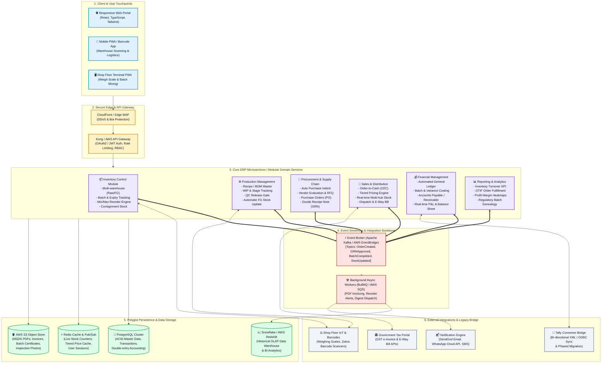

# Task 3: High-Level Architecture Diagram & ERP Design
**Project:** Integrated Cloud ERP & Inventory Management Solution  
**Client:** Paint & Chemical Manufacturing Enterprise  
**Transition:** From Excel Spreadsheets & Isolated Tally to Unified Cloud ERP  
**Prepared by:** Nikhil (Full Stack Developer Candidate)  
**Date:** November 2026  
**Document Version:** 1.0.0

---

## 1. Executive Summary & Problem Context

The client is a medium-to-large **paint manufacturer** facing severe operational bottlenecks due to fragmented legacy tools:
* **Production & Inventory in Excel Spreadsheets:** Prone to human errors, untracked inventory shrinkage, lack of real-time batch visibility, missing raw material expiry tracking (critical for solvent/binder shelf life), and frequent production delays due to unexpected stockouts.
* **Financials in Tally Prime / ERP 9:** Disconnected from the shop floor and warehouse. Sales, procurement, and inventory costs must be manually re-keyed into Tally, causing reporting delays of weeks, reconciliations errors, and inaccurate batch-level gross margin figures.
* **Objective:** Design an end-to-end, event-driven, modular ERP and Inventory Management platform that unifies **Procurement, Production, Inventory, Sales, Finance, and Executive Analytics** into a secure, scalable, single source of truth.

---

## 2. High-Level Architecture Diagram (Mermaid)

---

## 3. Core Functional Modules & Detailed Workflows

### 3.1 Inventory Control Module
* **Multi-Location Hierarchy:** Central Plant Warehouse $\rightarrow$ Regional Distribution Centers (RDCs) $\rightarrow$ Consignment Dealer Depots.
* **Raw Materials vs. Finished Goods:** Distinct tracking for base chemicals (Solvents, Resins, Titanium Dioxide pigments, Biocides) and finished goods (Paints, Primers, Emulsions in 1L, 4L, 10L, 20L SKUs).
* **Batch-Wise & Expiry Management:**
  * Mandatory batch lot assignment upon Goods Receipt Note (GRN).
  * Shelf-life tracking with automated **FEFO (First-Expired, First-Out)** picking rules to prevent chemical degradation.
  * Automated alerts triggered 60, 30, and 15 days prior to raw material expiration.
* **Automated Reordering Engine:** Dynamic calculation based on:
  $$\text{Reorder Point (ROP)} = (\text{Average Daily Usage} \times \text{Lead Time}) + \text{Safety Stock}$$
  Triggers automated internal indents when safety thresholds are breached.

---

### 3.2 Production Management Module
* **BOM & Recipe Formulation Master:**
  * Multi-level Bill of Materials supporting base formulation + color tinting master recipes.
  * Strict version control for chemical formulation changes.
* **Work-In-Progress (WIP) Tracking Stages:**
  $$\text{Pre-Assembly / Weighing} \longrightarrow \text{High-Speed Dispersion / Grinding} \longrightarrow \text{Let-down & Mixing} \longrightarrow \text{QC Lab Check} \longrightarrow \text{Automated Packing}$$
* **QC Gate & Finished Goods Induction:**
  * Automated hold on batches pending viscosity, color shade delta-E, and drying time verification.
  * Upon QC sign-off, system automatically issues finished stock to inventory and reconciles raw material consumption variances against standard BOM.

---

### 3.3 Sales & Distribution Module
* **Automated Order-to-Cash (O2C):**
  $$\text{Customer Order} \longrightarrow \text{Stock Check} \longrightarrow \text{Credit Limit Check} \longrightarrow \text{Pick/Pack} \longrightarrow \text{Invoice/E-Way Bill} \longrightarrow \text{Dispatch}$$
* **Real-Time Stock Availability:** Multi-hub visibility ensures sales reps confirm orders against stock at the nearest regional warehouse.
* **Tiered Pricing & Schemes:**
  * Dynamic pricing tiers based on customer category (Wholesale Distributor, Authorized Dealer, Industrial Contractor).
  * Volume rebate engine and seasonal promotional discounts.

---

### 3.4 Procurement & Supply Chain Module
* **Procure-to-Pay (P2P) Flow:**
  * Automated purchase indents converted to RFQs (Request for Quotations).
  * Comparative quotation analysis and multi-level approval workflows for Purchase Orders (PO).
  * Three-way matching: PO $\leftrightarrow$ Goods Receipt Note (GRN) $\leftrightarrow$ Vendor Bill.
* **Vendor Performance Matrix:** Automated vendor scorecards tracking **OTIF (On-Time In-Full)** percentage, batch defect rate, and price competitiveness.

---

### 3.5 Financial Management & Tally Integration
* **Automated Operational Accounting:**
  * Every inventory movement triggers automated double-entry ledger postings (e.g., Raw Material Consumption debits Work-in-Progress and credits Raw Material Inventory).
* **Batch Costing & Variance Analysis:**
  * Standard costing vs. Actual costing comparison per batch (tracking solvent evaporation loss, machine hour rates, and packaging variance).
* **Tally Integration Strategy:**
  * **Phase 1 (Hybrid Coexistence):** Lightweight Tally XML Connector Service running on-premise. It syncs validated sales invoices, purchase bills, and payment vouchers into Tally via Tally XML HTTP interface, ensuring the finance team has zero disruption.
  * **Phase 2 (Gradual Migration):** Native General Ledger, Accounts Receivable/Payable, and GST E-Invoicing within the ERP, enabling deprecation of Tally once complete audit parity is proven.

---

### 3.6 Reporting & Business Analytics
* **Executive Central Cockpit:**
  * Inventory Turnover Ratio: $\frac{\text{Cost of Goods Sold}}{\text{Average Inventory Value}}$
  * Order Fulfillment Rate (OTIF) by region and plant.
  * Product category profitability heatmaps (Emulsions vs. Enamels vs. Industrial coatings).
* **Traceability & Compliance:**
  * **End-to-End Batch Genealogy:** Immediate backward and forward traceability (Which raw material batch went into which paint bucket, sold to which dealer).

---

## 4. Key Architectural Considerations

### 4.1 Modularity & Microservice Boundaries
* Domain-Driven Design (DDD) separates the application into loosely coupled domains (Inventory, Production, Sales, Finance).
* Modules communicate asynchronously through an **Event-Driven Backbone (Apache Kafka / AWS EventBridge)**. A failure or peak load in the Sales module does not impact ongoing shop-floor production recording.

### 4.2 Scalability & Performance
* **Polyglot Persistence:**
  * **PostgreSQL:** ACID compliance for core ledger, inventory balance, and transactional integrity.
  * **Redis:** In-memory caching for active pricing rules, token sessions, and instant stock availability queries.
  * **AWS S3:** Private object storage for batch certificates, MSDS sheets, and digital invoices with short-lived presigned URLs.
* Horizontal auto-scaling of stateless application containers via AWS ECS / EKS behind AWS Application Load Balancers.

### 4.3 Security & Governance
* **Authentication & Authorization:** OAuth2.0 / JWT with fine-grained Role-Based Access Control (RBAC). A warehouse operator cannot view finance statements or modify recipe formulas.
* **Data Protection:**
  * TLS 1.3 encryption in transit.
  * AES-256 encryption at rest (AWS KMS managed keys for DB and S3).
* **Audit Trail:** Immutable transaction log tracking `created_by`, `timestamp`, `old_value`, and `new_value` for all recipe modifications, inventory adjustments, and financial entries.
